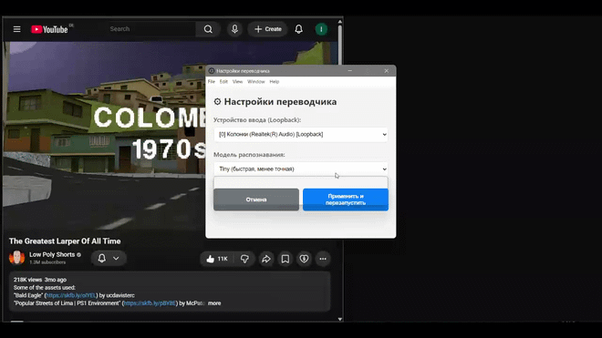

# 🌐 VOICE_COCKS

> **Мгновенный перевод речи EN → RU прямо поверх Discord, YouTube и любых других приложений. Полностью локально.**



---

## ⚡ Быстрый старт

### Вариант A — готовый установщик (рекомендуется)

1. Скачай последний релиз `VoiceCocks Setup *.exe` со страницы [Releases](https://github.com/Anti6ot/Voice_Cocks/releases).
2. Установи и запусти.
3. Выбери устройство и модель → готово, субтитры появятся внизу экрана.

### Вариант B — из исходников (одним кликом)

Что нужно поставить один раз:
- **Python 3.12** — https://www.python.org/downloads/release/python-3120/ (галочка *"Add Python to PATH"*)
- **Node.js LTS** — https://nodejs.org/

Затем:
1. Дважды кликни по `start_electron.bat`.
2. Выбери устройство вывода и модель распознавания.
3. Нажми **«Применить и перезапустить»**.

Появятся:
- консоль **«Субтитры и перевод»** — лог распознанного и переведённого текста;
- прозрачный **overlay субтитров** поверх всех окон.

`start_electron.bat` при первом запуске сам создаст `venv`, установит зависимости и Electron, и скачает модели (перевод ~160 МБ + модель распознавания, 3–5 минут).

### Управление overlay

| Действие | Как |
|---|---|
| Перетащить | потянуть за верхнюю полоску окна |
| Растянуть | потянуть за уголок в правом нижнем углу |
| Поверх всех окон | включено всегда |
| Закрыть | закрой консоль «Субтитры и перевод» — overlay закроется автоматически |

---

## 🛠 Для разработчиков

```bash
git clone https://github.com/Anti6ot/Voice_Cocks.git
cd Voice_Cocks

# Бэкенд (WebSocket :8765 + HTTP-настройки :8766)
py -3.12 -m venv venv
venv\Scripts\activate
pip install -r requirements.txt
python server.py

# Overlay (Electron) в другом терминале
cd overlay
npm install
npx electron .
```

---

## 🏗 Архитектура

```
Системный звук → PyAudioWPatch (WASAPI Loopback) → VAD → faster-whisper → ctranslate2 → overlay
```

- **Бэкенд (`server.py`)** — захват звука, распознавание речи, перевод; отдаёт субтитры по WebSocket `:8765` и настройки по HTTP `:8766`.
- **Overlay (`overlay/`)** — Electron-окно, которое показывает субтитры поверх всех окон.

---

## 🚀 О проекте

**VOICE_COCKS** перехватывает системный звук, распознаёт английскую речь и мгновенно показывает русский перевод в полупрозрачном overlay поверх всех окон. Без облачных API — всё работает локально на ПК.

| 🛡️ Приватность | ⚡ Скорость | 🎯 Универсальность | 🎨 Эстетика |
| :--- | :--- | :--- | :--- |
| 100% локальная обработка — звук и текст не покидают компьютер. | `faster-whisper` + `ctranslate2` — минимальная задержка. | Любой источник звука (Discord, Zoom, YouTube, Twitch) без виртуальных кабелей. | Прозрачный, всегда-поверх-окон overlay, который можно двигать и растягивать. |

---

## 📝 Известные ограничения

- Перевод только **английский → русский**.
- Распознавание может ошибаться при сильном фоновом шуме.
- Нужно устройство вывода (наушники/колонки).
