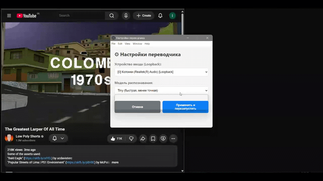

# 🎧 VOICE_COCKS — переводчик Discord / YouTube (EN → RU) в реальном времени




**Переводчик речи в реальном времени** для Discord, YouTube и любых других приложений.
Захватывает системный звук, распознаёт английскую речь и выводит перевод на русский
в виде субтитров поверх всех окон. Всё работает **локально**, без облачных API.

---

## ✨ Возможности

- 🎧 **Захват системного звука** через WASAPI Loopback — работает с любым приложением (Discord, Zoom, YouTube, Twitch, игры).
- 🗣️ **Распознавание речи** на базе `faster-whisper` (модели `tiny` / `base` / `small` / `medium`).
- 🌐 **Мгновенный перевод** EN → RU через `ctranslate2` + `opus-mt-en-ru`.
- 🖥️ **Прозрачный overlay субтитров** поверх всех окон, включая игры.
- ⚙️ **Окно настроек** — выбор устройства вывода и модели распознавания.
- 📌 **Всегда поверх окон**, можно двигать и растягивать.
- 🔒 **100% локальная обработка** — звук и текст не покидают компьютер.

---

## 🏗 Архитектура

```
┌─────────────────────────────┐          WebSocket :8765          ┌──────────────────────────────┐
│  Electron (overlay + настройки) │ ◄──────────────────────────────► │  Python (бэкенд)              │
│  • субтитры поверх окон       │                                   │  • захват звука (WASAPI)      │
│  • выбор устройства и модели │           HTTP :8766               │  • распознавание (faster-whisper) │
└─────────────────────────────┘ ◄──────────────────────────────────► │  • перевод (ctranslate2)      │
                                                                      └──────────────────────────────┘
```

### Технологический стек

| Компонент | Технология |
|---|---|
| Захват звука | `PyAudioWPatch` (WASAPI Loopback) |
| Распознавание речи | `faster-whisper` (CTranslate2) |
| Перевод | `ctranslate2` + `opus-mt-en-ru` |
| Сегментация речи | `webrtcvad-wheels` |
| Связь | `websockets` (WebSocket) + `http.server` |
| Overlay | `Electron` (Chromium) |

---

## 📋 Требования

### Для готового установщика (`.exe`)

Ничего не нужно — просто скачай и запусти.

### Для запуска из исходников

- **ОС:** Windows 10/11
- **Python:** 3.12.x ([скачать](https://www.python.org/downloads/release/python-3120/)) — при установке поставь галочку *"Add Python to PATH"*
- **Node.js:** LTS ([скачать](https://nodejs.org/))
- **Git** ([скачать](https://git-scm.com/))
- **Интернет** — только для первой загрузки моделей

---

## 🚀 Установка

### Вариант A — готовый установщик (рекомендуется)

1. Скачай последний релиз `VoiceCocks Setup *.exe` со страницы [Releases](https://github.com/Anti6ot/Voice_Cocks/releases).
2. Установи и запусти.
3. Выбери устройство и модель → готово, субтитры появятся внизу экрана.

### РЕКОМЕНДОВАННЫЙ Вариант B — из исходников (одним кликом) ЕСЛИ Exeшник битый

1. Установи Python 3.12, Node.js LTS и Git.
2. Клонируй репозиторий:

```bash
git clone https://github.com/Anti6ot/Voice_Cocks.git
cd Voice_Cocks
```

3. Запусти:

```bash
.\start_electron.bat
```

`start_electron.bat` сам найдёт Python 3.12, создаст `venv`, установит зависимости и Electron, и запустит приложение.

При первом запуске автоматически скачаются:
- модель перевода `opus-mt-en-ru` (~160 МБ);
- модель распознавания `faster-whisper` (размер зависит от выбранной).

Это может занять **3–5 минут**.

> ⚠️ Если Electron не устанавливается (ошибка `Electron failed to install correctly`), выполни:
> ```bash
> cd overlay\node_modules\electron
> node install.js
> cd ..\..
> ```

---

## 🎮 Использование

1. Запусти приложение (`start_electron.bat` или установленный `.exe`).
2. Дождись окна **⚙ Настройки**.
3. Выбери устройство вывода и модель распознавания.
4. Нажми **«Применить и перезапустить»**.
5. Появятся консоль «Субтитры и перевод» и прозрачный overlay субтитров.

### Управление overlay

| Действие | Как |
|---|---|
| Перетащить | потянуть за верхнюю полоску окна |
| Растянуть | потянуть за уголок в правом нижнем углу |
| Поверх всех окон | включено всегда |
| Закрыть | закрой консоль «Субтитры и перевод» — overlay закроется автоматически через несколько секунд |

---

## ⚙️ Настройки

### Выбор устройства

Приложение захватывает звук **устройств вывода** (наушники, колонки) через WASAPI Loopback.
Переводится всё, что играет на компьютере: голос в Discord, видео на YouTube, подкасты, игры.

### Выбор модели распознавания

| Модель | Размер | Скорость | Точность |
|---|---|---|---|
| `tiny` | ~40 МБ | ⚡ Очень быстро | ⭐⭐ |
| `base` | ~75 МБ | ⚡ Быстро | ⭐⭐⭐ |
| `small` | ~250 МБ | 🐢 Средне | ⭐⭐⭐⭐ |
| `medium` | ~770 МБ | 🐌 Медленно | ⭐⭐⭐⭐⭐ |

> 💡 Для игр и Discord — `tiny` или `base`. Для лекций и подкастов — `small` или `medium`.

---

## 📁 Структура проекта

```
Voice_Cocks/
├── server.py                 # бэкенд: WebSocket :8765 + HTTP-настройки :8766
├── config_server.py          # HTTP-сервер настроек (используется внутри server.py)
├── audio_capture.py          # захват звука через WASAPI
├── vad.py                    # детектор речи (VAD)
├── asr.py                    # распознавание речи (faster-whisper)
├── translator.py             # перевод EN → RU (ctranslate2)
├── requirements.txt          # Python-зависимости
├── settings.json             # сохранённые настройки
├── start_electron.bat        # запуск одним кликом
│
├── .github/workflows/        # сборка установщика (GitHub Actions)
├── LICENSE                   # лицензия MIT
│
├── models/                   # модели (скачиваются автоматически)
│   └── opus-mt-en-ru/
│
└── overlay/                  # Electron-приложение
    ├── package.json
    ├── main.js               # главный процесс (запускает бэкенд в сборке)
    ├── preload.js            # мост между процессами
    ├── index.html            # overlay субтитров
    ├── renderer.js           # логика overlay (drag / resize / WebSocket)
    ├── settings.html         # окно настроек
    └── settings.js           # логика настроек
```

---

## 🔧 Ручной запуск (без `start_electron.bat`)

**Терминал 1 — бэкенд (WebSocket `:8765` + HTTP-настройки `:8766`):**

```bash
venv\Scripts\python.exe server.py
```

**Терминал 2 — overlay:**

```bash
cd overlay
npx electron .
```

---

## 🐛 Решение проблем

### «Устройства не найдены»

Убедись, что есть работающие устройства вывода: **Параметры → Звук → Вывод**.

### «Модель перевода не найдена»

Удали папку `models/opus-mt-en-ru` и перезапусти приложение — модель скачается заново.

### «Ошибка загрузки Electron»

```bash
cd overlay\node_modules\electron
node install.js
```

### «Перевод обрывается на длинных фразах»

Увеличь `max_utterance_ms` в `server.py`:

```python
segmenter = Segmenter(aggressiveness=2, silence_ms=1000, max_utterance_ms=15000)
```

### «Overlay не появляется поверх полноэкранной игры»

Используй режим **«Окно без рамки»** (Borderless), а не «Эксклюзивный полный экран» — в нём ни одно приложение не может рисовать поверх игры.

### «Низкая скорость перевода»

Используй модель `tiny` или `base`.

---

## 📊 Системные требования

| Компонент | Минимум | Рекомендуется |
|---|---|---|
| **ОС** | Windows 10 | Windows 11 |
| **CPU** | 4 ядра, 2.0 ГГц | 6+ ядер, 3.0+ ГГц |
| **ОЗУ** | 4 ГБ | 8+ ГБ |
| **Диск** | 1 ГБ свободно | 2 ГБ (модели) |
| **Интернет** | только для первой загрузки | — |

---

## 🔒 Конфиденциальность

Все данные обрабатываются **локально**. Приложение не отправляет звук или текст на внешние серверы. Интернет используется только для первичной загрузки моделей.

---

## 📝 Известные ограничения

- Перевод только **английский → русский**.
- Распознавание может ошибаться при сильном фоновом шуме.
- Для работы нужно устройство вывода (наушники/колонки).

---

## 🚀 Планы на будущее

- [ ] Поддержка других языков (немецкий, французский, японский)
- [ ] Настройка размера шрифта и прозрачности overlay
- [ ] История переводов
- [ ] Горячие клавиши для управления
- [x] Упаковка в `.exe` через `electron-builder` (GitHub Actions)
- [ ] Режим работы с микрофоном (перевод собственной речи)

---

## 📄 Лицензия

[MIT](LICENSE)

---

## 👨‍💻 Автор

[Anti6ot](https://github.com/Anti6ot)

---

## ⭐ Поддержка проекта

Если проект оказался полезным — поставь ⭐ на репозитории.
